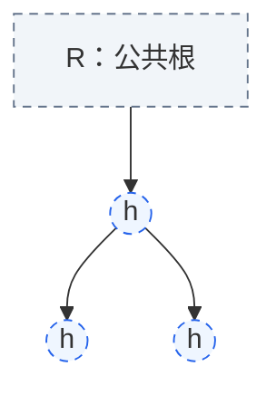
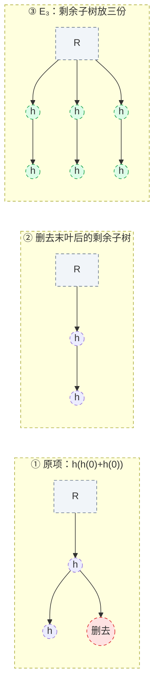
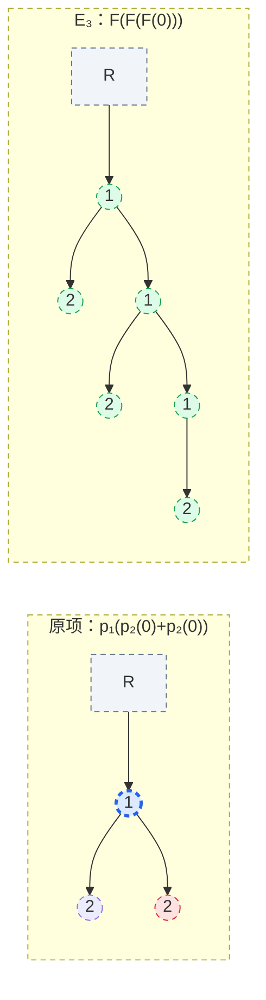
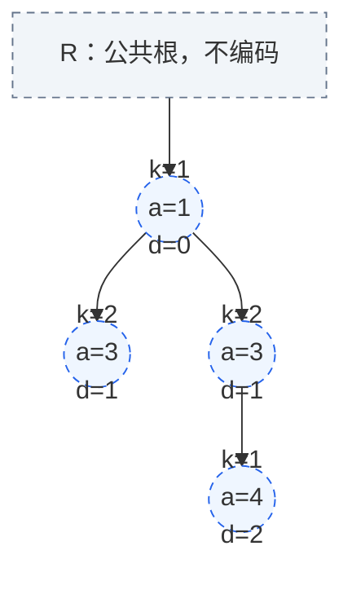
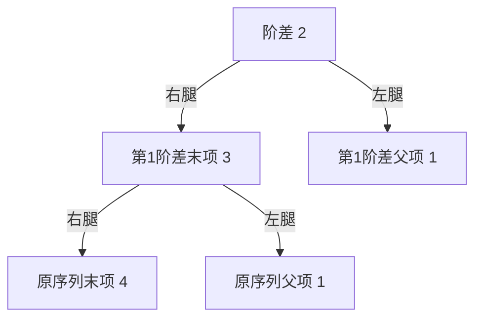
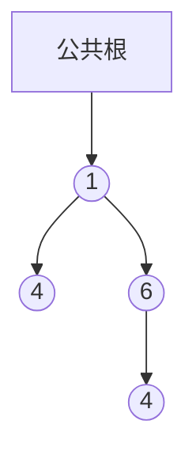
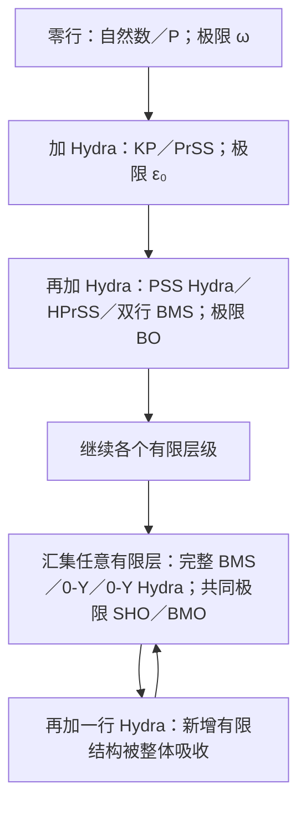

# Hydra 层级、展开规则与不同表示形式

本文所有记号均作为序数记号讨论。“给一个纯数字序列记号加一行 Hydra”，需要说明新增树结构怎样取基本列、节点标签怎样参与展开，以及复制的结构怎样回填。本篇从自然数记号出发，依次写出 KP Hydra、PrSS、PSS Hydra 和 HPrSS 的具体操作，再说明它们与矩阵表示的关系。

这里的“行”指构造层级。在矩阵中体现为行数，在树、括号和纯数字序列中则未必写成多行。我们研究的路线是：

\[
\text{自然数记号}\ \xrightarrow{+\text{一行 Hydra}}\
\text{KP Hydra／PrSS}\ \xrightarrow{+\text{一行 Hydra}}\
\text{PSS Hydra／HPrSS／双行 BMS}.
\]

## 0. 本文的统一约定

一次展开使用参数 \(q\ge1\)，**q 表示最终保留的副本总数，或嵌套的上下文总层数**。用 \(E_q\) 表示这次操作。

本文统一按副本总数 q 标记基本列项，便于直接比较各表示中的算例。极限项 A 满足 \(A=\sup_{q\ge1}E_q(A)\)；后继项则按规则取前驱。

“+”在括号记号中表示按顺序并列。所有展开都固定处理最右侧的末叶；带标签时，末叶是最右侧最内层的 \(p_k(0)\)。

空项表示序数 0；后继项删除相应末端后得到前驱；极限项通过展开规则给出基本列。下文中的树、括号、序列和矩阵，都是这些序数项的不同写法。

## 1. 零行：自然数记号

空序列表示 0，n 个 0 并排表示自然数 n：

```text
()          → 0
(0)         → 1
(0,0)       → 2
(0,0,0)     → 3
```

规则只有一条：非空时删掉最后一个 0。例如：

```text
(0,0,0) → (0,0) → (0) → ()
```

它在表达能力上相当于通常的 P 记号，可以视为零行记号。所有有限长度都允许，故极限为 ω。

## 2. 第一行 Hydra：KP Hydra

### 2.1 树怎样写成括号

用 \(h(A)\) 表示一个节点，其内部的 A 是有序排列的子树。\(h(0)\) 是叶子；\(A+B\) 是两部分并排。

为简洁起见，不写共同的最外部根节点，而把根下的子树写成一个森林：

```text
0                    只有公共根，没有其他节点
h(0)                 公共根下有一片叶子
h(0)+h(0)            公共根下有两片叶子
h(h(0))              从公共根出发的一条两节点链
h(h(0)+h(0))         一个节点下挂两片叶子
```

若坚持用每对括号表示节点，可把 `h(A)` 写成 `(A)`；本文使用 h 是为了避免把空森林、叶子、序列括号混淆。

下图对应 `h(h(0)+h(0))`。虚线框的 R 是省略不写的公共根；每个圆形节点对应一个 h。左右子节点的顺序对应括号内的书写顺序，节点数值 0 不另画为节点。



圆形节点 A 的两个子节点都是叶子：各表示 `h(0)`；它们共同被 A 包含，所以整个表达式是 `h(h(0)+h(0))`。

### 2.2 KP Hydra 的具体展开规则

找到最右侧叶子 \(h(0)\)，记它的父节点为 v。

**情形一：v 是公共根。**直接删掉这片叶子。

\[
A+h(0)\longmapsto A.
\]

**情形二：v 不是公共根。**先删掉叶子；然后把以 v 为根的剩余子树，放 q 份在 v 原来所在的位置。

用括号写，若局部结构为

\[
h(A+h(0)),
\]

就替换成

\[
\underbrace{h(A)+\cdots+h(A)}_{q\text{ 份}}.
\]

外部的树保持不动。注意复制的是“叶子的父节点及其删叶后剩余的全部子树”，不是只复制叶子的兄弟。

### 2.3 例一：一条短链展开成自然数

\[
h(h(0))\xrightarrow{E_3}h(0)+h(0)+h(0).
\]

过程是：删掉内侧叶子，外侧 h 成为叶子；把这个外侧叶子保留 3 份。

随后每次删除一个顶层叶子：

\[
h(0)+h(0)+h(0)\to h(0)+h(0)\to h(0)\to0.
\]

### 2.4 例二：只复制局部父子树

\[
h(h(0)+h(0))\xrightarrow{E_3}
 h(h(0))+h(h(0))+h(h(0)).
\]

先删最右侧叶子，原来包含两片叶子的节点剩下一片叶子；将整个剩余子树 \(h(h(0))\) 复制为 3 份。

下图从左到右列出三个阶段。红色表示待删除的末叶，绿色表示展开结果；中间阶段只是操作示意，不是另一个基本列项。



复制范围包括父节点 A 及它保留的左叶子；因此结果是三条两节点链，不是给原来的 A 再挂三片叶子。

再如：

\[
h(h(h(0)))\xrightarrow{E_3}
 h(h(0)+h(0)+h(0)).
\]

这里被复制的是中间节点删叶后形成的叶子；最外侧的 h 保持不动。因此并非每次都复制整棵树。

### 2.5 它怎样表示序数

在标准、按序排列的括号表达式中，把

\[
h(A)\quad\text{解释为}\quad\omega^{o(A)},
\]

并列解释为相应的 Cantor 和。例如：

| KP 括号 | 序数 |
|---|---|
| 0 | 0 |
| h(0) | 1 |
| h(0)+h(0) | 2 |
| h(h(0)) | ω |
| h(h(0)+h(0)) | ω² |
| h(h(h(0))) | ω^ω |

任意有限深度的迭代指数都可以表达，整体极限为 ε₀。本篇采用标准的有序表达式，以便将树形项、Cantor 正规形及序列表示直接对照。[1][2]

## 3. PrSS：把 KP Hydra 写成纯数字序列

### 3.1 编码方法

按从左到右、先访问父节点再访问子节点的顺序遍历树，记录每个非公共根节点的深度，并把公共根的直接子节点记为深度 0。

| KP 括号 | PrSS |
|---|---|
| 0 | () |
| h(0) | (0) |
| h(0)+h(0) | (0,0) |
| h(h(0)) | (0,1) |
| h(h(0)+h(0)) | (0,1,1) |
| h(h(h(0))) | (0,1,2) |

序列从 0 开始；向右增加深度时最多增加 1，向上退回则可以下降多级。这样记录的是同一棵树，括号被深度信息替代。

### 3.2 PrSS 的展开算法

给定 \(S=(s_1,\ldots,s_m)\)：

1. 空序列表示 0，不再操作。
2. 若末项为 0，删除末项。
3. 若末项 L>0，从末项向左找到最近的小于 L 的项，称为坏根。
4. 坏根之前的部分为好部 G；从坏根开始直到倒数第二项为坏部 B。
5. 删除末项，以 q 份 B 代替原来的坏部：

\[
S=(G,B,L)\quad\Longrightarrow\quad E_q(S)=(G,\underbrace{B,\ldots,B}_{q}).
\]

在这里的 PrSS 深度序列中，坏根就是末叶的父节点。[3]

### 3.3 完整例子

取

\[
S=(0,1,2,3,3,3).
\]

末项是最后的 3；向左跳过另外两个 3，最近的小数是 2，因此：

```text
好部 G = (0,1)
坏部 B = (2,3,3)
末项 L = 3
```

取 q=3：

\[
E_3(S)=(0,1,2,3,3,2,3,3,2,3,3).
\]

这正是删掉最右叶子以后，把其父节点及剩余子树复制成 3 份。

前面两个短例子也直接变成：

\[
E_3(0,1)=(0,0,0),
\]

\[
E_3(0,1,1)=(0,1,0,1,0,1),
\]

\[
E_3(0,1,2)=(0,1,1,1).
\]

所以 KP Hydra 与 PrSS 的对应可以直接从展开过程看出来：**一个操作树，一个操作树的深度序列。**两者的极限均为 ε₀。

## 4. 再加一行 Hydra：PSS Hydra

### 4.1 记号与标签

现在使用 \(p_k(A)\)，k 为正整数，表示标签为 k 的节点，内部 A 是子节点森林。\(p_k(0)\) 是标签为 k 的叶子；最小标签为 1。

只使用标签 1 时，它退化为前面的无标签 KP 括号结构。出现更高标签以后，新增的是另一类找层与嵌套再生规则。

为了保证找层能进行，通常采用这样的语法约束：顶层节点标签为 1；标签为 k 的节点内部，其直接子节点的标签至多为 k+1，可以低于 k。以下例子均满足此约束。[4]

### 4.2 先定位最右叶子

每次从右向左处理表达式的末端，直到找到最右侧的 \(p_n(0)\)。规则分成三种。

#### A. 标签 1 的叶子位于顶层：直接删除

\[
E_q(A+p_1(0))=A.
\]

这是后继操作，与参数无关。

#### B. 标签 1 的叶子位于某节点内部：并排复制父节点

若它最近的外层节点为 \(p_k\)，局部结构写成

\[
p_k(A+p_1(0)),
\]

则删掉该叶子，把剩余父子树复制 q 份：

\[
p_k(A+p_1(0))\longmapsto
\underbrace{p_k(A)+\cdots+p_k(A)}_{q}.
\]

再把这些副本放回原来的外部位置。这是普通 KP 再生的带标签版本。

#### C. 末叶标签 n>1：找标签 n−1 的外层节点，再嵌套复制

从末叶向外回溯，找到最近的 \(p_{n-1}\)。记 k=n−1，把该节点及其内部写成：

\[
p_k(C[p_{k+1}(0)]).
\]

其中 C[□] 表示从选中节点内部到末叶之间的全部上下文，□ 是末叶的位置；途中没有另一个 \(p_k\)，否则就应选择更近的那个。

定义：

\[
F(X)=p_k(C[X]).
\]

用 q 次迭代替换整个选中的子树：

\[
p_k(C[p_{k+1}(0)])\longmapsto F^q(0).
\]

也就是：

\[
F(0),\quad F(F(0)),\quad F(F(F(0))),\ldots
\]

按参数选择有限项。选中节点外面的结构保持不变。

**这里是“加上去的 Hydra”最关键的作用：非最小标签触发向外找层，找到的上下文随后被不断嵌回末端，而非只做并列复制。**

### 4.3 例一：最小标签仍走普通再生

\[
P=p_1(p_2(0)+p_1(0)).
\]

末叶是 \(p_1(0)\)，父节点是外层 \(p_1\)。删除末叶后，剩余父子树为 \(p_1(p_2(0))\)。因此：

\[
E_3(P)=p_1(p_2(0))+p_1(p_2(0))+p_1(p_2(0)).
\]

### 4.4 例二：高标签叶子展开成任意长旧 Hydra 链

\[
P=p_1(p_2(0)).
\]

末叶标签 2，向外找到标签 1 的节点。此时 C 是空上下文，故 \(F(X)=p_1(X)\)：

\[
E_1(P)=p_1(0),
\]

\[
E_2(P)=p_1(p_1(0)),
\]

\[
E_3(P)=p_1(p_1(p_1(0))).
\]

展开结果分别对应 \(1,\omega,\omega^\omega,\ldots\)，所以这一简单表达式表示 ε₀。

这具体说明：原来一行系统的整体极限，在新系统里成为一个能够继续参与组合的项。

### 4.5 例三：复制的是带旁支的完整上下文

\[
P=p_1(p_2(0)+p_2(0)).
\]

处理最后的 \(p_2(0)\)，向外找到 \(p_1\)。这次

\[
F(X)=p_1(p_2(0)+X).
\]

因此：

\[
E_1(P)=p_1(p_2(0)),
\]

\[
E_2(P)=p_1(p_2(0)+p_1(p_2(0))),
\]

\[
E_3(P)=p_1(p_2(0)+p_1(p_2(0)+p_1(p_2(0)))).
\]

每一层都保留了原来位于末叶左边的 \(p_2(0)\) 旁支。只写“向上复制”会漏掉这一点；明确 F 才能算出结果。

下图圆内数字就是节点标签。红色的标签 2 是待展开末叶；蓝色节点是向外找到的标签 1 参考节点。右侧结果沿右分支嵌套三层，每层左边都保留一个标签 2 的叶子。



右图的标签 1 节点形成新的嵌套骨架，标签 2 的左旁支被逐层带入；这与 KP 例子中并排摆放三个剩余子树是两种不同的展开形态。

### 4.6 例四：可以跨过标签不匹配的外层

\[
P=p_1(p_2(p_2(0))).
\]

最右叶子标签 2。紧邻的外层标签也为 2，不能作为标签 1 的参考节点，因此继续向外找到最外的 \(p_1\)。

此时：

\[
F(X)=p_1(p_2(X)).
\]

所以：

\[
E_3(P)=p_1(p_2(p_1(p_2(p_1(p_2(0)))))).
\]

这展示了标签实际控制找层距离与复制上下文，而不只是给节点着色。

## 5. HPrSS：把带标签 Hydra 压成纯数字序列

### 5.1 数字记录什么

在这里采用的转换中，每个节点对应一个数字：**它等于从当前顶层节点到该节点路径上所有标签之和。**仍按先父后子、从左到右记录。

例如：

\[
p_1(p_2(0)+p_2(p_1(0)))
\quad\longleftrightarrow\quad(1,3,3,4).
\]

逐项解释：顶层标签 1 写为 1；两个标签 2 的子节点都写为 1+2=3；最后标签 1 的孙节点写为 1+2+1=4。

下图把每个节点写成“标签 k／累计值 a”。按父节点优先、子节点从左到右读取累计值，便得到 `(1,3,3,4)`。深度 d 则用于下一节的矩阵表示。



同一棵树编码为双行 BMS 时，各节点写成 `(d,k−1)`，依次为 `(0,0)(1,1)(1,1)(2,0)`；这幅图因此也把树、HPrSS 和双行矩阵的对应放在了一起。

若用 LP 表示编码，则：

\[
LP(0)=(),\qquad LP(A+B)=LP(A)\mathbin\Vert LP(B),
\]

\[
LP(p_k(A))=(k)\mathbin\Vert(LP(A)+k),
\]

其中 \(\Vert\) 是拼接，\(LP(A)+k\) 表示每项加 k。[5]

当所有标签都为 1 时，编码就是节点深度加 1；于是恢复为从 1 开始书写的 PrSS。

### 5.2 父项、标签与阶差

HPrSS 是以 1 开头的正整数序列。空序列表示 0；末项为 1 时删除末项。

对其他项 \(a_i\)，其父项是左侧最近的小于它的项 \(a_{p(i)}\)。定义：

\[
d_i=a_i-a_{p(i)}.
\]

无父项时把其父值视为 0。对于上述树编码，**阶差 d_i 就是节点自身的标签**。

所以，数字不是孤立的高度值：父项给出树的接入位置，阶差给出节点标签。

### 5.3 HPrSS 的展开算法

设末项为 \(a_m>1\)，末项阶差为 \(d_m\)。

1. 若 \(d_m=1\)，坏根就是末项的父项。
2. 若 \(d_m>1\)，沿末项的祖先链向左回溯，找到最近的阶差严格小于 \(d_m\) 的祖先，作为坏根。不能在整个序列中任意找符合条件的项。
3. 设坏根值为 \(a_r\)。好部 \(G=(a_1,\ldots,a_{r-1})\)，坏部 \(B=(a_r,\ldots,a_{m-1})\)。
4. 计算整体偏移：

\[
\delta=a_m-a_r-1.
\]

5. 删除末项，把坏部复制成 q 块，第 t 块的每一项加 \(t\delta\)：

\[
E_q(S)=G\mathbin\Vert B\mathbin\Vert(B+\delta)
\mathbin\Vert\cdots\mathbin\Vert(B+(q-1)\delta).
\]

注意区分每个位置的阶差 \(d_i\) 与复制时的整体偏移 δ。前者用于找根，后者用于生成副本。[5]

### 5.4 对照例一：并列复制

\[
p_1(p_2(0)+p_1(0))\longleftrightarrow(1,3,2).
\]

末项 2 的父项为 1，所以末项阶差为 1，坏根是首项：

```text
G = ()
B = (1,3)
δ = 2−1−1 = 0
```

因此：

\[
E_3(1,3,2)=(1,3,1,3,1,3).
\]

解码后正是三份 \(p_1(p_2(0))\) 并列。

### 5.5 对照例二：嵌套复制

\[
p_1(p_2(0)+p_2(0))\longleftrightarrow(1,3,3).
\]

末项父值为 1，末项阶差为 2；沿祖先链找到首项，其阶差为 1。于是：

```text
G = ()
B = (1,3)
δ = 3−1−1 = 1
```

三块分别是：

```text
B       = (1,3)
B+δ     = (2,4)
B+2δ    = (3,5)
```

故：

\[
E_3(1,3,3)=(1,3,2,4,3,5).
\]

解码后得到：

\[
p_1(p_2(0)+p_1(p_2(0)+p_1(p_2(0)))),
\]

与 PSS Hydra 的上下文嵌套例子完全对应。逐块上移的数字，记录了新增嵌套所积累的路径标签和。

### 5.6 一个找根不能只找父项的例子

取

\[
S=(1,4,6,6).
\]

其阶差序列为：

\[
(1,3,2,2).
\]

末项的父项是 4，但其阶差 3 大于末项阶差 2，因此不能作为坏根；继续沿祖先链到首项 1，其阶差 1<2，选它作为坏根。

```text
G = ()
B = (1,4,6)
δ = 6−1−1 = 4
```

取 q=3：

\[
E_3(S)=(1,4,6,5,8,10,9,12,14).
\]

这就是 HPrSS 超出普通 PrSS 的一个具体表现：标签阶差参与找根，复制的坏部还会逐块抬升。

## 6. 双行 BMS：把树深度与标签分开写

PSS Hydra 到双行 BMS 的转换很直接：仍按先父后子遍历，每个节点写成一列

\[
(\text{深度},\ \text{标签}-1),
\]

顶层节点深度为 0。两行分别记录树结构与节点等级。[4]

例如：

\[
p_1(p_2(0)+p_2(0))
\longleftrightarrow(0,0)(1,1)(1,1).
\]

HPrSS 通过路径标签和把信息合并进单串数字，BMS 则把两部分分开记录。

### 6.1 双行展开的直接算法

为让矩阵也能独立操作，给出所需的两行规则。写每列为 \((x_i,y_i)\)。

- 第一行父列：左侧最近的、第一行值小于当前值的列。
- 第二行父列：沿第一行祖先链寻找，取其中最近的、第二行值小于当前值的列。
- 若末列全为 0，删除末列。
- 若末列第二行非零，使用第二行父列作坏根；否则使用第一行父列。
- 好部 G 与坏部 B 仍分别是坏根左侧，以及从坏根到倒数第二列。
- 若末列第二行为 0，复制 B 时不增加任何元素。
- 若末列第二行非零，令 Δ 为“末列第一行减坏根第一行”。第 t 个块把第一行增加 tΔ；只对第一行祖先链包含坏根的列增加，其他列保持原值。第二行保持不变。
- 最终拼接 q 个块，必要时消去底部全零行。

这就是本篇所需的双行 BMS 展开；祖先限制在更复杂例子中重要，不能总把整个坏部无条件平移。[1][6]

### 6.2 同一个例子的三种展开

仍取：

\[
p_1(p_2(0)+p_2(0))\longleftrightarrow(1,3,3)
\longleftrightarrow(0,0)(1,1)(1,1).
\]

末列第二行的父列为首列，所以坏部为 \((0,0)(1,1)\)，第一行偏移 Δ=1。q=3 时：

```text
第0块：(0,0)(1,1)
第1块：(1,0)(2,1)
第2块：(2,0)(3,1)
```

得到：

\[
(0,0)(1,1)(1,0)(2,1)(2,0)(3,1).
\]

三种表示的结果汇总为：

| 表示 | 展开前 | E₃ 展开后 |
|---|---|---|
| PSS Hydra | p₁(p₂(0)+p₂(0)) | p₁(p₂(0)+p₁(p₂(0)+p₁(p₂(0)))) |
| HPrSS | (1,3,3) | (1,3,2,4,3,5) |
| 双行 BMS | (0,0)(1,1)(1,1) | (0,0)(1,1)(1,0)(2,1)(2,0)(3,1) |

这个对照展示了同一次展开：Hydra 复制嵌套上下文，HPrSS 生成递增坏部块，BMS 增加相应节点的深度。

## 7. 从实际展开看，“加一行 Hydra”增加了什么

现在可以把层级关系写得更具体。

**自然数记号**只有并排计数，展开就是删除末项。

**加第一行 Hydra**后，有了无标签树的嵌套。末叶若不直接连公共根，删除它便触发剩余父子树的复制；PrSS 用深度序列记录这个过程。整体极限从 ω 到 ε₀。

**再加一行 Hydra**后，节点携带数字标签。最小标签继续执行普通再生；非最小标签根据数字所决定的层级向外找根，并把整个上下文不断嵌回末端。PSS Hydra 直接写出这个过程；HPrSS 用父项和阶差把它编码为纯数字序列；双行 BMS 用树深度与标签两行记录。整体极限通常记为 BO。

| 层级 | 主要表示 | 展开的新增内容 | 极限 |
|---|---|---|---|
| 零行 | 自然数／P 记号 | 删除最后一个单位 | ω |
| 单行 | KP Hydra ↔ PrSS | 删叶后复制剩余父子树 | ε₀ |
| 双行 | PSS Hydra ↔ HPrSS ↔ 双行 BMS | 标签找层，并排或嵌套复制上下文 | BO |

用户所说的“给纯数字序列再加一行 Hydra”，应当沿这个构造理解：基础数字规则负责指导标签相关的展开，新增的 Hydra 负责树形包含、回溯与再生。若继续从 HPrSS 构造 HPrSS Hydra，也应写出相应具体规则，而不能只说“更高一层”便算完成定义。

继续增加 Hydra 层级以后，需要把有限层级的全体、它的纯数字编码以及相应的树形表示一起考虑。下面继续讨论完整 BMS、0-Y 和 0-Y Hydra。

## 8. 不断加行的极限：BMS 与 0-Y

### 8.1 “不断加行”的终点是什么意思

前面的零行、单行、双行只是开头。继续沿同一种多层 Hydra 构造推进，每个阶段使用有限层级；将所有有限层级合在一起，就得到这里所讨论的整体范围。

这个“终点”不是一张实际写了无限行的矩阵。**每个表达式仍然有限，只是整个系统不再规定统一的行数上限。**

用矩阵表示，这就是完整 BMS；用纯数字序列及其阶差山脉编码，则是 0-Y。二者整体极限在本文语境下称为 BMO／SHO。

| 范围 | 矩阵表示 | 其他表示 | 整体极限 |
|---|---|---|---|
| 零行 | 只记自然数个单位 | 自然数／P 记号 | ω |
| 单行 | 单行 BMS | KP Hydra／PrSS | ε₀ |
| 双行 | 双行 BMS | PSS Hydra／HPrSS | BO |
| 任意有限行 | 完整 BMS | 0-Y 的纯数字编码 | BMO／SHO |

这是一条构造与表示的总体路线；尤其是有限行到对应 Hydra 扩展的每一步，仍须采用相配的找根、复制规则，不能只从名字相似推出等价。

### 8.2 BMS 怎样同时容纳所有有限行

BMS 使用有限的自然数矩阵，每一列写成一个括号。各行都有父关系：第一行向左找最近的较小值；后续行只在上一行祖先链中找较小值。

对末列，找到最下面仍有父关系的一行，取这一行的父列作为坏根。从坏根到倒数第二列构成坏部。复制时，决定层上方的行可能增加偏移，而增加仅作用于相应行上依赖坏根的元素。

用列 L 表示末列、R 表示坏根，决定层为 t，行号从上往下计，则上方第 y 行的偏移为：

\[
\Delta_y=L_y-R_y\quad(y<t),\qquad\Delta_y=0\quad(y\ge t).
\]

第 k 块中，只有第 y 行祖先链包含坏根的元素才加 \(k\Delta_y\)。最后拼接 q 个块，消去底部全零行。这就是前面双行规则的多行版本。[1][6]

最简单的种子族是：

\[
I_h=(0^h)(1^h),
\]

其中 \(0^h\) 表示 h 个 0 组成的一列，\(1^h\) 同理。h≥2 时：

\[
E_q(I_h)=(0^{h-1})(1^{h-1})\cdots((q-1)^{h-1}).
\]

例如三行项：

\[
(0,0,0)(1,1,1)\xrightarrow{E_3}(0,0)(1,1)(2,2).
\]

更高层的简单项，可以展开成较低层的长链；而较低层链内部又有自己的展开。因此，有限层级之间通过基本列衔接起来。

种子族

\[
(0)(1),\quad(0,0)(1,1),\quad(0,0,0)(1,1,1),\ldots
\]

是整体极限的共尾逼近。它的每一项只是一个普通有限矩阵，整体上确界才是 BMO／SHO。

### 8.3 0-Y 怎样把任意有限行装进一串数字

0-Y 表达式是以 1 开头的正整数序列，另允许空序列。空序列表示 0；末项为 1 时删除末项取前驱；末项大于 1 时构造阶差山脉，决定基本列。[7]

第一层是原序列。对每个值大于 1 的位置，找左侧较小值作父项，并写下两者的差，得到上一层；从第二层起，选父项还须服从下一层的祖先关系。值为 1 的位置继续向上写 1。

例如：

```text
上层边界    1  1  1  1
第2阶差     1  2  1  2
第1阶差     1  3  2  3
原序列      1  4  6  4
```

以原序列末项 4 为例：它的父项是首项 1，差为 3；上一层末项 3 的父项仍在首列，差为 2；再上一层末项 2 与其父项 1 的差为 1。到这里就能确定展开所需的坏根为首列。

数字路径上的差分关系，可以画成山脉的两条腿。以末列这条链为例，竖线连接同列，斜线连接父项：



沿一对腿向下还原时，满足“当前值＝上方阶差值＋父项值”。因此一串数字可隐含多层依赖，逐层取阶差便能把它们恢复出来。

将各层的父链深度记录为矩阵行，得到：

\[
(1,4,6,4)\longleftrightarrow
(0,0,0)(1,1,1)(2,1,0)(1,1,1).
\]

这说明 0-Y 的纸面形式虽只有一串数字，却能编码三行乃至任意有限行 BMS。

### 8.4 0-Y 的具体展开

对末列逐层取阶差，首次发现末项与父项之差为 1 的层作为决定层，其父列为根列。

1. 保留根列及其左侧结构。
2. 取根列右侧至末列的山脉为坏部，保留其连线。
3. 将决定层的末项减 1，擦去坏部在该层以下的数值。
4. 坏部保留 q 份；复制连线时，连到根列严格左侧的左腿端点固定不动。
5. 由上向下、每行从左到右，用“阶差＋父项值”回填。
6. 读出底行，作为基本列项。

例如上面的序列，在本文按条目算例固定的 q=3 约定下：

\[
D_3(1,4,6,4)=(1,4,6,3,7,10,6,11,15,10).
\]

把复制的三块标出，更容易看清：

```text
保留根列     第0块      第1块        第2块
   1       | 4,6,3 | 7,10,6 | 11,15,10
```

这里单独写 D_q，是因为来源中 0-Y 的基本列与前面 BMS 的总块数约定存在末项边界差异；不能把同名下标不加检查地逐项等同。互译的概念关系不要求读者先解决这个编号问题。

其整体共尾种子族为：

\[
(1,2),\quad(1,3),\quad(1,4),\quad(1,5),\ldots
\]

与 BMS 的 \(I_1,I_2,I_3,I_4,\ldots\) 对应。完整 BMS 展示有限层级本身，0-Y 则把这些层级编码为纯数字序列。

## 9. 那么，0-Y Hydra 放在哪里？

### 9.1 它问的是极限层级上的 Hydra 化

PrSS 加 Hydra 得到 PSS Hydra；HPrSS 还能进一步考虑其 Hydra 形式。沿这条思路，0-Y Hydra 就是在已经容纳任意有限层级的 0-Y 基础上，再组织一层树形的包含、找根和复制。

表示上可以用 \(p_a(A)\) 这样的带数字标签节点；但展开时不能机械照搬 PSS 的“标签减 1、找最近的前一级”作为全部规则，而应由 0-Y 的阶差山脉决定相应的数字展开与参考结构。否则定义出来的是另一套带标签树。

以下图示仅说明表示结构：节点上写数字，括号给出外加的 Hydra 包含关系；它不是未经说明的 0-Y Hydra 完整算例。



这里有两种信息共同存在：树给出新的包含关系，数字展开则要求调用 0-Y 的内部层次。要算基本列，二者必须有明确的结合规则。

### 9.2 为什么 0-Y Hydra 与 0-Y 的极限相同

**0-Y Hydra、0-Y 和完整 BMS 的整体极限相同，均为 BMO／SHO。**

在固定的有限层级上加一行 Hydra，会进入下一个层级；而 0-Y 已经汇集了任意有限层级。每个 0-Y Hydra 表达式只包含有限个节点和有限深度的树，其新增的 Hydra 结构可以容纳在某个更高、但仍然有限的层级中。因此它仍属于完整的有限层级范围。

另一方面，原有层级也保留在 Hydra 表示之中，所以它并未缩小整体范围。两者结合，说明在这个极限处加一行 Hydra，整体极限保持不变。

可以把这种吸收关系概括为：

> 对每一个具体表达式，都能找到足够高的有限层级容纳它；但不存在一个固定的有限层级，能够容纳整个系统。

这也解释了“不断加行的终点”：每个有限阶段仍能继续提高，而汇集所有有限阶段以后，再加一层有限 Hydra 结构仍被这一整体吸收。这里说的是当前这条加行路线的闭合，不是所有序数构造的绝对终点。

### 9.3 三者是同一整体层级的不同表示

三者应放在同一个整体层级中：

| 表示 | 结构特点 | 整体极限 |
|---|---|---|
| 完整 BMS | 任意有限行的矩阵 | BMO／SHO |
| 0-Y | 以阶差山脉恢复内部层级的纯数字序列 | BMO／SHO |
| 0-Y Hydra | 在 0-Y 基础上组织树形包含与再生 | BMO／SHO |

因此，主线应写为：

\[
\boxed{\text{完整 BMS、0-Y、0-Y Hydra：同一整体极限 BMO／SHO}}
\]

这里的极限相同，不要求三者在纸面上写出同样的表达式，也不要求使用完全相同的基本列编号。本文已有的 0-Y 山脉算法与 BMS 矩阵算法分别说明前两种表示如何操作；0-Y Hydra 的具体基本列还需要写清数字展开与树形复制怎样结合，不能用“极限相同”代替其操作规则。

整体图可以归纳为：



## 10. 规则与算例的核对

本文采用共同的总副本数 q，把不同资料的编号约定统一。已用独立的树操作与 HPrSS 数列操作，核对以下四个例子的 E₃ 结果一致：

- p₁(p₂(0)+p₁(0))；
- p₁(p₂(0))；
- p₁(p₂(0)+p₂(0))；
- p₁(p₂(p₂(0)))。

另核对了 HPrSS 的 (1,4,6,6) 阶差例子。程序只是检查文中有限算例，不要求先完成所有互译的形式化证明。

可复现材料：[算例检查程序](<research_sources/verify_hydra_examples.py>)、[逐例结果](<research_sources/hydra_example_results.json>)。

## 参考资料

1. Rachel Hunter，[Well-Orderedness of the Bashicu Matrix System](https://arxiv.org/html/2307.04606v3)：BM4 定义、PrSS 与双行系统的序型背景。
2. [Kirby–Paris Hydra](https://wiki.googology.top/index.php?title=Kirby-Paris_Hydra)：树形展开的操作参考。本文直接采用序数项与基本列的表述，以副本总数 q 标记各项，并固定最右叶子以便与序列表示对应。
3. [初等序列系统 PrSS](https://wiki.googology.top/index.php?title=初等序列系统)：好部、坏部、坏根与复制展开。
4. [PSS Hydra](https://wiki.googology.top/index.php?title=PSS_Hydra)：带标签节点的三类操作，以及到双行 BMS 的转换。
5. [超初等序列 HPrSS](https://wiki.googology.top/index.php/超初等序列)：阶差找根、逐块偏移与 Hydra 转换。原条目第二种坏根条件写为 d≥1，与第一种重叠；本文依分支含义写为 d>1。
6. [BMS](https://wiki.googology.top/index.php?title=BMS)：父项与偏移掩码的中文说明。
7. [0-Y](https://wiki.googology.top/index.php?title=0-Y)：多阶差山脉、展开算例及与 BMS 的转换说明。条目同时指出一般转换结论尚缺严格证明；本篇按其明确算法和算例介绍，不要求展开证明。
8. [SHO](https://wiki.googology.top/index.php?title=SHO)：当前中文社区的 BMO／SHO 命名背景；不据该页断言完整极限的精确传统序数刻画已完成。
